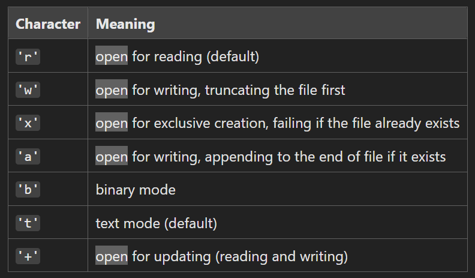

# Module

Single Python file containing reusable code such as functions, classes or variables
```python
# arithmetic.py

def double(number):
    return number * 2

def half(number):
    return number / 2
```
```python
# main.py

from arithmetic import double

print double(5)
```

# Package

Directory containing multiple modules
```python
maths/ Package
</> arithmetic.py Module
</> statistics.py Module
```
```python
# main.py

from maths.arithmetic import double

print double(5)
```

# Libraries

Collection of packages that provide related functionality (e.g. Python standard library)
```python
import random

print(random.randint(1, 10))
```

# .txt

## open()

Accesses file
```python
file = open("order.txt", "r")
content = file.read()
print(content)
file.close()
```

## with open()

Automatically closes file when indented block finishes
```python
with open("order.txt", "r") as file:
    content = file.read()
    print(content)
```

## Modes

Second argument in `open()` function tells Python what to do with the file



### "r"

```python
def open_and_print_file(file):
    with open(file, "r") as opened_file:
        for line in opened_file:
            print(line.strip())

open_and_print_file("order.txt")
```
Returns each line from `order.txt` file
- `line.strip()` removes line breaks and extra white space before and after string

### "a"

```python
def update_file(file, order_item):
    with open(file, "a") as opened_file:
        opened_file.write(order_item + "\n")

update_file("order.txt", "butter")
```
Appends new item to `order.txt` file
- Avoid `"w"` as this will truncate and overwrite the file

# Control Flow

Flow continues even in case of error
```python
try:
    file = open("ord3r.txt")
except FileNotFoundError as errmsg:
    print("File Not Found")
    print(errmsg)
```
Returns `File Not Found` and `[Errno 2] No such file or directory: 'ord3r.txt'`

```python
try:
    file = open("ord3r.txt")
except FileNotFoundError as errmsg:
    print("File Not Found")
    print(errmsg)
finally:
    file.close()
```
`finally` always runs even if an error is not caught by an `except` clause

# .csv

## Extract

```python
import csv

with open("user_details.csv", newline = "") as csv_file:
    csv_reader = csv.reader(csv_file, delimiter = ",")
    for row in csv_reader:
        print(row)
```

## Transform

```python
import csv

def transform_user_details():
    extracted_details = []
    with open("user_details.csv", newline="") as csv_file:
        csv_reader = csv.reader(csv_file, delimiter=",")
        for row in csv_reader:
            user = []
            user.append(row[1])
            user.append(row[2])
            user.append(row[4])
            extracted_details.append(user)
    return extracted_details

print(transform_user_details())
```

## Load

```python
import csv

from csv_transform import transform_user_details

def load_transformed_details(old_file_name, new_file_name):
    transformed_user_details = transform_user_details()
    with open(new_file_name, "w", newline = "") as new_file:
        csv_writer = csv.writer(new_file)
        csv_writer.writerows(transformed_user_details)

load_transformed_details("user_details.csv", "new_user_details.csv")
```

# .json

## .dumps

Convert dictionary to json-formatted string
```python
import json

car_data = {
    "name": "tesla",
    "engine": "electric"
}

car_data_json_string = json.dumps(car_data)
print(car_data_json_string)
print(type(car_data_json_string))
```
Returns `{"name": "tesla", "engine": "electric"}` and `<class 'str'>`

## .loads

Convert json-formatted string to dictionary
```python
parsed_json_data = json.loads(car_data_json_string)
print(parsed_json_data)
print(type(parsed_json_data))
```
Returns `{'name': 'tesla', 'engine': 'electric'}` and `<class 'dict'>`

## .dump

Convert dictionary to .json file
```python
with open("new_json_file.json", "w") as new_json_file:
     json.dump(car_data, new_json_file)
```
Creates new .json file containing `{"name": "tesla", "engine": "electric"}`

## .load

Convert .json file to dictionary
```python
with open("new_json_file.json") as opened_json_file:
     car = json.load(opened_json_file)
     print(car)
     print(type(car))
```
Returns `{'name': 'tesla', 'engine': 'electric'}` and `<class 'dict'>`

# urllib

Fetch and parse data from URL
```python
import urllib.request

import json

url = "http://jsonplaceholder.typicode.com/todos/1"

with urllib.request.urlopen(url) as raw_json:
    converted_json = json.load(raw_json)

print(converted_json)
print(type(converted_json))
```
Returns `{'userId': 1, 'id': 1, 'title': 'delectus aut autem', 'completed': False}` and `<class 'dict'>`