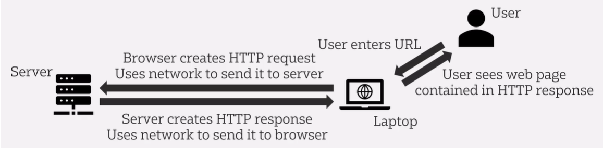

# Hypertext Transfer Protocol (HTTP)

Application layer protocol for transmitting hypermedia documents (e.g. HTML)
- Communication between web browsers and web servers
- HTTPS = encrypted



## Command Prompt

- curl [url]
- curl -v [url] = more detailed output (verbose)
    - `Text:` = header
    - `*` = connection details
    - `>` = HTTP request
    - `<` = HTTP response

## Status Codes

[HTTP Cats](https://http.cat/)
- 1XX = information
- 2XX = successful
- 3XX = redirection
- 4XX = client error
- 5XX = server error

## Request Methods

- GET (retrieve data e.g. by typing url or clicking link)
- POST (submit information back to the server e.g. by filling out a form)
- PUT
- DELETE
- PATCH

# JavaScript Object Notation (JSON)

Commonly used for data interchange
- Human readable plain text
- Store data using {objects} and [arrays]
- Key-Value pairs
    - Strings
    - Numbers
    - Boolean
    - Arrays
    - JSON object
    - Null

```json
person={
    "firstName": "Mary",
    "lastName": "Poppins",
    "age": 34,
    "isEmployed": true,
    "likes": ["medicine", "bags", "magic"]
    "address":{
        "houseNumber": 123,
        "streetName": "Brick Lane",
        "city": "London"
    },
    "car": null
}
```

# REST API

Application Programming Interface (API) = mechanism that allows two computer programs to communicate with each other

Representational State Transfer (REST) = way to design web services that are simple, scalable, and easy to integrate (architectural style)

## Technologies

- Message exchange = HTTP
- Location, action, target description = Uniform Resource Identifier (URI) and HTTP methods
- Data representation = JSON
    - XML / HTML also used but less common
- Service description = swagger/openAPI
- Endpoint = URL

## Implementation

CRUD (Create, Read, Update, Delete) = how we access data 
- Create = Post (if entity does not already exist) or Put (if it does not exist it gets created otherwise it gets updated)
- Read = Get
- Update = Patch (if entity already exists) or Put
- Delete = Delete

`REST API provides CRUD access to data store using HTTP as transport and JSON as representation`

---

[Postman Public APIs](https://www.postman.com/cs-demo/public-rest-apis/overview?sideView=agentMode)

[GitHub Public APIs](https://github.com/public-apis/public-apis)