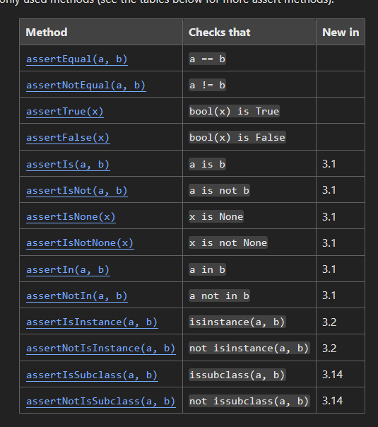

# Test-Driven Development

Write a failing test before you write the code that passes the test
1. Red: write test and watch it fail
2. Green: write just enough code to pass test
3. Refactor: clean up code and tests

### Pros

- Fewer defects (bugs surface immediately during production)
- Safe refactoring (tests let you know immediately if you broke something)
- Better design (code tends to be modular and loosely coupled)
- Living documentation (tests demonstrate how each function works)
- Clear scope (stop when tests pass)
- Faster debugging (failing test = recent change)

### Cons

- Slower at first (more upfront time)
- Learning curve (writing good tests is a skill)
- Brittle tests (break on every refactor and become a burden)
- False confidence (missed edge cases and integration problems)
- Poor fit for exploration (change too fast)
- Legacy code is hard (tightly coupled)

## Example

### Red

```python
# test_palindrome.py

from palindrome import is_palindrome

def test_is_palindrome():
    assert is_palindrome("racecar") == True
```
Returns an error because `palindrome.py` does not exist yet

### Green

```python
# palindrome.py

def is_palindrome(text):
    return text == text[::-1]
```
Test now runs successfully

### Red

```python
# test_palindrome.py

from palindrome import is_palindrome

def test_mixed_case():
    assert is_palindrome("Racecar") == True
```
Returns an error because code does not account for capital letters

### Green

```python
# palindrome.py

def is_palindrome(text):
    text = text.lower()
    return text == text[::-1]
```
Test now runs successfully

### Red

```python
# test_palindrome.py

from palindrome import is_palindrome

def test_spaces():
    assert is_palindrome("never odd or even") == True
```
Returns an error because code does not account for spaces

### Green

```python
# palindrome.py

def is_palindrome(text):
    text = text.lower().replace(" ", "")
    return text == text[::-1]
```
Test now runs successfully

### Refactor

Add type hint
```python
# palindrome.py

def is_palindrome(text: str) -> bool:
    text = text.lower().replace(" ", "")
    return text == text[::-1]
```
Run tests again to confirm code still works

# Unit Testing

Test individual components (e.g. functions, methods, classes, modules) in isolation

### Principles

- Fast
- Independent
- Repeatable
- Self-validating
- Timely

### Arrange, Act, Assert

Structure every test into three clear blocks
1. Arrange = set up inputs and expected result
2. Act = call the code
3. Assert = check the outcome

```python
def test_discount()

    price = 50.0

    result = apply_discount(price, percent = 10)

    assert result == 45.0
```

## Example

### Red

```python
# test_calculator.py

from calculator import add

import unittest

class TestCalculator(unittest.TestCase):
    def test_add_equals_2(self):
        self.assertEqual(add(1, 1), 2)
    
if __name__ == '__main__':
    unittest.main()
```

### Green

```python
# calculator.py

def add ():
    return 2
```

### Red

```python
# test_calculator.py

from calculator import add

import unittest

class TestCalculator(unittest.TestCase):
    def test_add_equals_2(self):
        self.assertEqual(add(1, 1), 2)
    
    def test_add_equals_3(self):
        self.assertEqual(add(1, 2), 3)

if __name__ == '__main__':
    unittest.main()
```

### Green

```python
# calculator.py

def add (num1, num2):
    return num1 + num2
```

### Refactor

```python
# test_calculator.py

from calculator import add

import unittest

class TestCalculator(unittest.TestCase):
    def test_add_equals_2(self):
        self.assertEqual(add(1, 1), 2)
    
    def test_add_equals_3(self):
        self.assertEqual(add(1, 2), 3)
    
    def test_add(self):
        actual_result = add(10, 5)
        expected_result = 15
        self.assertEqual(actual_result, expected_result)

if __name__ == '__main__':
    unittest.main()
```

## Assert Methods



# Pytest

```python
import pytest

from calculator import add

@pytest.mark.parametrize('num1, num2, expected_result', [
    (2, 1, 1),
    (10, 5, 5),
    (20, 10, 10)
])

def test_subtract(num1, num2, expected_result):
    assert add(2, 1) == 3
```
`parametrize` = run same test with mutliple inputs